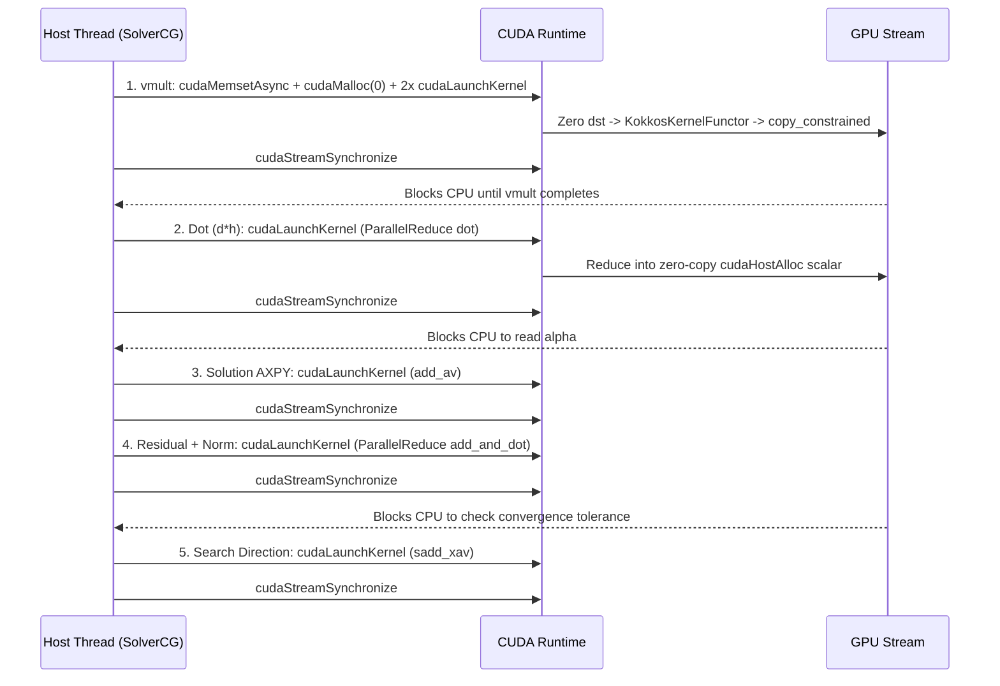

# CEED BP3 (`bp3_opt`) System-Level Bottlenecks & Operational Problems Report

**Diagnostic Method**: NVIDIA Nsight Systems (`nsys 2025.6.1`, `--trace=cuda,osrt`) + SQLite Timeline & API Event Correlation  
**Evaluated Configuration**: `./build/bp3_opt <p> 1000 1000000` ($p = 1 \dots 8$, `82` cycles, 1 MPI Rank / 1 GPU on NVIDIA RTX 1000 Ada `sm_89`)  
**Scope Constraint**: System-level operational diagnosis only—**zero modifications** to the designed Kokkos kernel infrastructure or repository source structure (`0` bytes diff). Detailed cycle-by-cycle execution tables are provided in companion report [NSYS_EXECUTION_TIMES_REPORT.md](NSYS_EXECUTION_TIMES_REPORT.md).

---

## Executive Summary of System-Level Problems

System-level tracing across all eight polynomial orders ($p = 1 \dots 8$) over `1,000`–`1,000,000` DoFs shows that while [`BK3Opt::Parallel::KokkosKernelFunctor`](include/bk3_kokkos_kernel_opt.h#L49-L444) dominates GPU compute at large DoF counts, **substantial wall-clock time is lost to host-device synchronization barriers, multi-kernel operator wrapper dispatches, unpreconditioned CG iteration growth, CPU-bound setup phases with unpinned (`Pageable -> Device`) transfers, GPU SM under-subscription at coarse high-order meshes, and repeated memory allocation churn**.

Across the `82` profiled cycles ($p = 1 \dots 8$), the process issued **`983,559` `cudaStreamSynchronize` barriers**, **`1,121,715` `cudaLaunchKernel` calls**, **`355,200` `cudaMemsetAsync` API calls (`351,592` GPU `[CUDA memset]` ops zeroing `464.1 GB` of VRAM)**, **`350,345` zero-byte `cudaMalloc` scratch probes**, and **`2,722` Host-to-Device copies (`4.94 GB`) with `0%` pinned memory usage**.

### Master Bottleneck Taxonomy

| # | System-Level Problem | Affected Phase / Component | Regime Where Most Severe | Measured Nsight Systems Impact |
| :-: | :--- | :--- | :--- | :--- |
| **P1** | **Per-Iteration `SolverCG` Host-Blocking Sync Cascade** (`7x cudaStreamSynchronize` + `6x` kernels/iter) | [`solve()`](src/bp3_opt.cc#L230-L257) (`dealii::SolverCG` + `VectorOperations`) | Small–Medium DoFs (`1k–70k`), High $p$ (`p=6..8`) | **`31.9%–57.5%` GPU-idle stall** + **`11.1%–20.2%` CG vec/red** at low DoFs; up to **`1.47 s` CG vec/red GPU time** at $p=6$ |
| **P2** | **Unpreconditioned `SolverCG` (`PreconditionIdentity`) Iteration Explosion** | [`solve()`](src/bp3_opt.cc#L232-L243) | Large DoFs (`250k–913k`) & High $p$ (`p=4..8`) | At `545,025` DoFs, `matvec` speeds up **5.40x** ($p=1 \to 8$), but `cg_its` jumps **2.57x** (`157` $\to$ `403`), erasing solver gains |
| **P3** | **Multi-Operation `vmult` Wrapper, Full-Vector Memset, Uncached Occupancy Probe & Hard Fence** | [`LaplaceOperatorOpt::vmult`](include/portable_laplace_operator_opt.h#L729-L826), [`KokkosKernelAsync`](include/bk3_kokkos_kernel_opt.h#L510-L517) | Every `vmult` (`1k–100k` DoFs especially) | Zeroes **`464.1 GB` VRAM** (`cudaMemsetAsync`) + separate `copy_constrained` kernel + `~10–16 us` sync gap (`15.7%–47.5%` low-DoF `mv` overhead) |
| **P4** | **CPU-Bound Setup (`70%–99.6%` GPU Idle), Duplicate Partitioner & `100%` Pageable HtoD Copies** | [`setup_dofs`](src/bp3_opt.cc#L133-L160), [`setup_operator`](include/portable_laplace_operator_opt.h#L391-L712) | All `Setup` phases (`p=1` cell count & `p=8` $n_q^3=1000$) | GPU sits **idle `84.7%–90.8%`** of setup at max DoFs; **`4943 MB`** copied via **`Pageable -> Device`** blocking host CPU |
| **P5** | **Dual Scaling Extremes: High-$p$ SM Under-Subscription Flatline vs. $p=1$ Cell/Traffic Explosion** | [`KokkosKernelAsync`](include/bk3_kokkos_kernel_opt.h#L482-L486) & mesh hierarchy | $p=6..8$ (`1k–18.5k` DoFs) & $p=1$ (`100k–545k` DoFs) | $p=8$ `matvec` flatlines at **`~83 us` across a 16x cell increase** (`2`–`32` cells, `1`–`16` blocks on `20` SMs); $p=1$ takes **`89.59 s`** (`3.67x` slower than $p=5$) |
| **P6** | **Per-Cycle Teardown & First-CG-Solve `GrowingVectorMemory` Allocation Churn** | [`release_cycle_memory`](src/bp3_opt.cc#L119-L129), [`solve`](src/bp3_opt.cc#L230-L243) | Cycle transitions & CG solve `i = 0` | **`1,727` real `cudaMalloc`** + **`1,562` `cudaFree`** calls (up to `~1.06 ms` per `cudaFree`), plus stale previous-cycle CG vectors held in VRAM |
| **P7** | **Benchmark Harness Repetition Amplification & Cold-Start Runtime Skew** | [`solve`](src/bp3_opt.cc#L230-L283), [`matvec_ghost_timing`](src/bp3_opt.cc#L304-L380) | Whole-application runtime | **`3,000` standalone `vmult`s/cycle** consume **`46.8%–70.7%`** of total process wall time (including `2,000` redundant single-rank sweeps/cycle) |

---

## Problem 1 — Per-Iteration `SolverCG` Host-Blocking Synchronization Cascade & Auxiliary Vector Overhead

### System Trace Observation

Inspecting the Nsight Systems `CUPTI_ACTIVITY_KIND_RUNTIME` and `CUPTI_ACTIVITY_KIND_KERNEL` event stream inside [`LaplaceProblemOpt::solve()`](src/bp3_opt.cc#L230-L257) reveals that **every single iteration of `dealii::SolverCG` executes `6` separate GPU kernel launches, `1` `cudaMemsetAsync`, `1` zero-byte `cudaMalloc` probe, and `7` blocking `cudaStreamSynchronize` calls**:



### Why It Hurts System Performance

1. **Zero Asynchronous Command Queueing Across Operations**: Because [`LaplaceOperatorOpt::vmult`](include/portable_laplace_operator_opt.h#L786) ends with `exec.fence()` (`cudaStreamSynchronize #1`) and `deal.II`'s `VectorOperations` synchronously fence after **pure device-to-device vector updates** (`add_av` `#4` and `sadd_xav` `#7`, neither of which returns a scalar to the host!), the CPU cannot enqueue the next GPU kernel while the current kernel runs. Every kernel launch pays the full host wakeup + `cuKernelGetName` + `cudaLaunchKernel` (`~3.1 us`) + hardware queue latency in series.
2. **Doubled Stream Fences on Every Inner Product**: Both `dot` and `add_and_dot` write their scalar result into pinned zero-copy host memory (`cudaHostAlloc`) and synchronize inside `Kokkos::parallel_reduce` (`~10.8 us`), immediately followed by a **second back-to-back `cudaStreamSynchronize`** (`~0.3 us`) from `deal.II`'s trailing `Kokkos::fence()`.
3. **Startup Zero-Check Reduction on Every Solve**: Before iteration `1` of each CG solve, `SolverCG` invokes `all_zero_local` (`10` times per cycle = `820` extra `ParallelReduce` + sync roundtrips across $p=1 \dots 8$) even though `solution_device = 0` was just executed on line 235 of [`src/bp3_opt.cc`](src/bp3_opt.cc#L235).

### Quantified Nsight Systems Evidence (`SolverCG` Phase Breakdown)

| Order $p$ | Low-DoF (`~1.3k` DoFs) `vmult` GPU % | Low-DoF `CG` Vec/Red GPU % | Low-DoF **Host/Sync Idle %** | High-DoF (`531k–913k`) `vmult` GPU % | High-DoF `CG` Vec/Red GPU % | Total `CG` Vec/Red GPU Time Across Sweep |
| :-: | --: | --: | --: | --: | --: | --: |
| **$p=1$** | `27.0%` | `18.5%` | **`51.8%`** | `98.0%` | `1.4%` | **`434.9 ms`** (`25,060` kernels) |
| **$p=2$** | `19.4%` | `20.2%` | **`57.5%`** | `94.6%` | `3.6%` | **`614.4 ms`** (`39,100` kernels) |
| **$p=3$** | `22.4%` | `18.6%` | **`56.4%`** | `92.9%` | `5.4%` | **`1185.7 ms`** (`51,170` kernels) |
| **$p=4$** | `29.9%` | `17.8%` | **`49.8%`** | `93.6%` | `4.4%` | **`693.1 ms`** (`49,260` kernels) |
| **$p=5$** | `36.2%` | `15.6%` | **`45.9%`** | `92.1%` | `5.3%` | **`637.9 ms`** (`52,052` kernels) |
| **$p=6$** | `42.8%` | `14.3%` | **`40.8%`** | `89.4%` | `8.0%` | **`1473.9 ms`** (`68,130` kernels) |
| **$p=7$** | `46.5%` | `12.6%` | **`39.0%`** | `91.2%` | `6.3%` | **`1173.7 ms`** (`69,060` kernels) |
| **$p=8$** | `55.4%` | `11.1%` | **`31.9%`** | `91.5%` | `5.7%` | **`863.0 ms`** (`66,340` kernels) |

---

## Problem 2 — Unpreconditioned `SolverCG` (`PreconditionIdentity`) Iteration Growth Across $p$ and DoFs

### System Trace Observation

In [`LaplaceProblemOpt::solve()`](src/bp3_opt.cc#L239-L242), the linear system is solved with `PreconditionIdentity()`. Because the condition number of the 3D $Q_p$ stiffness matrix scales as $\kappa(A) = O(h^{-2} p^4)$, unpreconditioned CG iteration counts grow as $O(N_{\text{DoF}}^{1/3} p)$.

### Quantified Impact at Fixed Problem Size (`545,025` DoFs)

- Moving from $p = 1$ to $p = 8$ at the **exact same `545,025` DoFs** accelerates a single `matvec` by **5.40x** (`10.288 ms` $\to$ `1.906 ms`, `53.0` $\to$ `286.0 MDoFs/s`).
- However, `SolverCG` iterations climb **2.57x** (`157` $\to$ `403` iterations), and comparing $p = 4$ (`306` iterations, `2.706 ms`/mv $\implies$ `875.1 ms` CG) against $p = 8$ (`403` iterations, `1.906 ms`/mv $\implies$ `828.8 ms` CG), **a 42% faster operator yields only a 5.3% faster linear solve** because 97 additional CG iterations multiply every `vmult`, vector update, dot-product reduction, and host synchronization stall.

---

## Problem 3 — Multi-Operation `vmult` Wrapper Overhead (`cudaMemsetAsync`, Separate Constraint Kernel, Runtime Probe & Hard `exec.fence()`)

### System Trace Observation

Even on a single GPU with no MPI ghost exchange (`has_ghost_exchange == false`), [`LaplaceOperatorOpt::vmult`](include/portable_laplace_operator_opt.h#L729-L788) does **not** execute as a single GPU kernel. Every `vmult` call performs **five sequential host/device actions**:

1. **`Kokkos::deep_copy(exec, dst_device, number(0))`** ([line 750](include/portable_laplace_operator_opt.h#L750)): Dispatches `cudaMemsetAsync` over the entire `dst_device` vector (`~2.8–3.0 us` host API time + global VRAM write traffic) because [`KokkosKernelFunctor`](include/bk3_kokkos_kernel_opt.h#L435) accumulates into `d_out` via `Kokkos::atomic_add`.
2. **Uncached Host Occupancy Query & 0-Byte `cudaMalloc` Scratch Probe** ([`bk3_kokkos_kernel_opt.h:510-513`](include/bk3_kokkos_kernel_opt.h#L510-L513)): Every single `KokkosKernelAsync` call constructs `TeamPolicy probe_policy(exec, 1, Kokkos::AUTO)` and queries `probe_policy.team_size_max(...)` on the CPU without caching per template instantiation, while Kokkos's `TeamPolicy` launch path issues a zero-byte `cudaMalloc` check (`350,345` calls across $p=1 \dots 8$).
3. **Main Operator Launch** (`BK3Opt::Parallel::KokkosKernelFunctor`).
4. **Separate Boundary Constraint Kernel** ([`copy_constrained_values_gpu`](include/portable_laplace_operator_opt.h#L256-L274)): Launches a second small `RangePolicy` kernel (`~2.7 us` host launch API + `~1.1–6.5 us` GPU execution) solely to copy `dst[dof] = src[dof]` on constrained Dirichlet boundary nodes.
5. **Hard Trailing Stream Fence** (`exec.fence()` at [line 786](include/portable_laplace_operator_opt.h#L786)): Blocks the host thread in `cudaStreamSynchronize` until all three GPU operations finish, introducing an observed **`10.3 us` to `18.5 us` dead GPU-idle gap** between consecutive `vmult` evaluations even in tight `for (j = 0; j < 200; ++j) do_matvec();` loops.

### Quantified Nsight Systems Evidence (Standalone `vmult` Decomposition)

| Order $p$ | Small-DoF (`~1.3k`) Kernel GPU (us) | Small-DoF Wrapper Overhead (`Memset+Constr+Sync Gap`) | Wrapper Share of Small-DoF `vmult` | Total VRAM Zeroed by `[CUDA memset]` | Total `Memset` + `copy_constrained` GPU Time | Total `Memset` + `copy_constrained` Host API Time |
| :-: | --: | --: | --: | --: | --: | --: |
| **$p=1$** | `21.7 us` | **`12.2 us`** (`2.1` + `10.2`) | **`36.1%`** | `37.27 GB` | `231.5 ms` | `253.2 ms` |
| **$p=2$** | `14.0 us` | **`12.7 us`** (`2.1` + `10.6`) | **`47.5%`** | `43.23 GB` | `230.6 ms` | `276.4 ms` |
| **$p=3$** | `17.6 us` | **`12.9 us`** (`2.0` + `10.8`) | **`42.2%`** | `76.77 GB` | `346.5 ms` | `311.8 ms` |
| **$p=4$** | `24.5 us` | **`12.3 us`** (`2.1` + `10.3`) | **`33.4%`** | `47.17 GB` | `208.9 ms` | `280.8 ms` |
| **$p=5$** | `43.5 us` | **`17.0 us`** (`2.7` + `14.3`) | **`28.1%`** | `45.34 GB` | `198.9 ms` | `299.5 ms` |
| **$p=6$** | `43.5 us` | **`12.9 us`** (`2.0` + `10.9`) | **`22.9%`** | `86.74 GB` | `366.6 ms` | `332.2 ms` |
| **$p=7$** | `54.0 us` | **`14.8 us`** (`2.1` + `12.7`) | **`21.5%`** | `73.04 GB` | `267.5 ms` | `333.6 ms` |
| **$p=8$** | `73.3 us` | **`13.6 us`** (`2.1` + `11.6`) | **`15.7%`** | `54.52 GB` | `216.4 ms` | `322.8 ms` |

---

## Problem 4 — CPU-Bound Setup (`70%–99.6%` GPU Idle), Duplicate Partitioner Extraction & `100%` Pageable Lockstep HtoD Transfers

### System Trace Observation

During the setup phase of every cycle ([`setup_dofs`](src/bp3_opt.cc#L133-L160) + [`setup_matrix_free`](src/bp3_opt.cc#L164-L183) + [`compute_rhs`](src/bp3_opt.cc#L187-L201)), Nsight Systems timeline segmentation shows that **the GPU is completely idle for `84.7%` to `90.8%` of total setup time at the largest meshes (`531k–913k` DoFs)** (and up to `99.6%` at the smallest meshes). Four system-level factors cause this:

1. **Serial Host Mesh, DoF & Constraint Construction**: `GridGenerator::subdivided_hyper_rectangle`, `triangulation.refine_global`, `dof_handler.distribute_dofs`, `DoFTools::extract_locally_relevant_dofs`, and `VectorTools::interpolate_boundary_values` execute single-threaded on the CPU while the GPU waits.
2. **Redundant `locally_relevant_dofs` & `Partitioner` Extraction**: [`LaplaceProblemOpt::setup_dofs`](src/bp3_opt.cc#L145) computes `DoFTools::extract_locally_relevant_dofs(dof_handler)`, and milliseconds later [`LaplaceOperatorOpt::setup_operator`](include/portable_laplace_operator_opt.h#L405-L410) **recomputes `DoFTools::extract_locally_relevant_dofs(dof_handler)` from scratch** to build a new `Utilities::MPI::Partitioner`.
3. **Serial Host `FEValues` Geometry Loop & Per-Tile `exec.fence()` Lockstep**: In [`setup_operator`](include/portable_laplace_operator_opt.h#L628-L708), the CPU serially extracts cell DoF indices (`get_dof_indices`) and serially evaluates `fe_values.reinit(cell)` (`MappingQ<3>(fe_degree)` inverse Jacobians and `JxW` at $(p+2)^3$ quadrature points per cell—reaching **`1,000` quadrature points per cell at $p=8$**, or **`524,288` cells at $p=1$**). After each `4,096`-cell tile, the code copies host buffers, launches [`fill_G_tensor_tile_gpu`](include/portable_laplace_operator_opt.h#L214-L252), and calls **`exec.fence()`** ([line 707](include/portable_laplace_operator_opt.h#L707)), preventing CPU preparation of tile $t+1$ from overlapping GPU execution of tile $t$.
4. **Unpinned (`Pageable -> Device`) Host Mirrors Blocking `cudaMemcpyAsync`**: Every `Kokkos::create_mirror_view` in [`setup_operator`](include/portable_laplace_operator_opt.h#L442-L672) allocates standard pageable `Kokkos::HostSpace` memory rather than `Kokkos::CudaHostPinnedSpace`. In CUDA, `cudaMemcpyAsync` from pageable host memory must synchronously stage data through an internal driver bounce buffer on the CPU before returning—causing **host `cudaMemcpyAsync` API blocking time (`249.5 ms` at $p=1$) to nearly equal total PCIe DMA time (`275.6 ms`)** at only `~8.0–8.3 GB/s` effective PCIe throughput.

### Quantified Nsight Systems Evidence (`Setup` Phase at Largest Cycle per Degree)

| Order $p$ | Largest Cycle Cells (`DoFs`) | Quadrature Pts/Cell ($n_q^3$) | `Setup DoFs` Wall (ms) | `Setup MF` Wall (ms) | `Compute RHS` Wall (ms) | Setup HtoD Pageable Volume (MB) | HtoD Host API Block (ms) | `fill_G_tensor` GPU (ms) | **Setup GPU Idle Share** |
| :-: | --: | --: | --: | --: | --: | --: | --: | --: | --: |
| **$p=1$** | `524,288` (`545,025`) | `27` | `104.66` | `431.19` | `4.477` | **`1149.41 MB`** | `124.26` | `49.65` (all cycles) | **`90.8%`** |
| **$p=2$** | `65,536` (`545,025`) | `64` | `37.50` | `202.25` | `1.544` | **`342.79 MB`** | `40.80` | `14.68` (all cycles) | **`86.6%`** |
| **$p=3$** | `32,768` (`912,673`) | `125` | `30.83` | `206.18` | `1.663` | **`336.29 MB`** | `40.75` | `17.96` (all cycles) | **`85.3%`** |
| **$p=4$** | `8,192` (`545,025`) | `216` | `15.24` | `106.23` | `0.830` | **`145.82 MB`** | `17.55` | `10.03` (all cycles) | **`84.7%`** |
| **$p=5$** | `4,096` (`531,441`) | `343` | `11.98` | `103.11` | `0.817` | **`116.09 MB`** | `14.49` | `12.18` (all cycles) | **`86.3%`** |
| **$p=6$** | `4,096` (`912,673`) | `512` | `15.69` | `156.75` | `1.058` | **`173.62 MB`** | `21.24` | `18.25` (all cycles) | **`85.7%`** |
| **$p=7$** | `2,048` (`727,833`) | `729` | `16.62` | `171.14` | `0.939` | **`123.84 MB`** | `15.14` | `21.43` (all cycles) | **`89.4%`** |
| **$p=8$** | `1,024` (`545,025`) | `1,000` | `13.23` | `116.58` | `0.730` | **`85.07 MB`** | `10.26` | `22.90` (all cycles) | **`88.8%`** |

---

## Problem 5 — Dual Scaling Extremes: High-Order ($p=6..8$) GPU Under-Subscription Flatline vs. Low-Order ($p=1$) Cell/Traffic Explosion

### 5A. High-Order ($p = 6, 7, 8$) Grid Under-Subscription & Wave Quantization (`1k–20k` DoFs)

In [`KokkosKernelAsync`](include/bk3_kokkos_kernel_opt.h#L479-L486), the grid size (`numBlocks`) defaults to:

```cpp
const unsigned int total_batches = (n_cells + nelmtPerBatch - 1u) / nelmtPerBatch;
numBlocks = std::max(1u, total_batches / 2u);
```

For $p \ge 4$, `nelmtPerBatch == 1`, so `numBlocks = max(1, n_cells / 2)`—meaning **each thread block sequentially processes `2` elements in its `while (eb < total_batches)` loop** even when the GPU has idle Streaming Multiprocessors (`20` SMs on RTX 1000 Ada, and `132` SMs on H100/GH200)!

- **Direct Evidence at $p = 8$ (Cycles `1`–`5`, `1,377` to `18,513` DoFs)**:

| Cycle ($p=8$) | Cells | DoFs | Launched Grid (`numBlocks`) | Active SMs (out of `20`) | Native `matvec` Best | Nsys `KokkosKernel` GPU Avg | Effective Throughput |
| :-: | --: | --: | :-: | :-: | --: | --: | --: |
| `1` | `2` | `1,377` | **`1`** | `1 / 20` (`5%`) | **`83.9 us`** | `73.3 us` | `16.4 MDoFs/s` |
| `2` | `4` | `2,601` | **`2`** | `2 / 20` (`10%`) | **`83.6 us`** | `73.3 us` | `31.1 MDoFs/s` |
| `3` | `8` | `4,913` | **`4`** | `4 / 20` (`20%`) | **`82.6 us`** | `73.5 us` | `59.5 MDoFs/s` |
| `4` | `16` | `9,537` | **`8`** | `8 / 20` (`40%`) | **`83.9 us`** | `73.7 us` | `113.7 MDoFs/s` |
| `5` | `32` | `18,513` | **`16`** | `16 / 20` (`80%`) | **`82.9 us`** | `73.8 us` | `223.4 MDoFs/s` |
| `6` | `64` | `35,937` | **`32`** | `20 / 20` (`100%`) | **`144.3 us`** | `131.2 us` | `249.0 MDoFs/s` |

Notice that **increasing problem size 16x from `2` cells (`1,377` DoFs) to `32` cells (`18,513` DoFs) produces an identical `~82.6–83.9 us` `matvec` execution time** (`~73.3–73.8 us` GPU kernel duration): `1` block looping over `2` cells on `1` SM takes the exact same wall time as `16` blocks looping over `2` cells each across `16` SMs while the remaining SMs sit idle!

### 5B. Low-Order ($p = 1$) Cell-Count, Geometry-Storage & Atomic-Scatter Bottleneck (`100k–545k` DoFs)

- Conversely, at $p = 1$, reaching `545,025` DoFs requires **`524,288` cells** (**512x more cells** than $p=8$'s `1,024` cells). Because the operator stores explicit per-quadrature-point $G$-tensors (`6 * 27 * 8 = 1,296` B/cell) and `dirichlet_boundary_dofs_masks` (`8 * 4 = 32` B/cell) even on affine cells, Cycle 19 alone transfers **`1,149.4 MB` HtoD** during setup (`540.3 ms`) and streams **`679 MB` of $G$-tensors** per `vmult` while scattering every cell contribution via global FP64 `atomic_add` (`use_coloring_per_color` is hardcoded to `false` in [`setup_operator`](include/portable_laplace_operator_opt.h#L586)).
- As a result, $p = 1$ requires **`89.59 s` total wall time** (`86.96 s` inside `KokkosKernelFunctor` at only `53.0 MDoFs/s` at `545k` DoFs)—**3.67x slower** end-to-end than $p = 5$ (`24.43 s`, `298.6 MDoFs/s`) and **3.22x slower** than $p = 8$ (`27.83 s`, `286.0 MDoFs/s`).

---

## Problem 6 — Per-Cycle Teardown & First-CG-Solve Device Memory Allocation Churn (`cudaMalloc` / `cudaFree`)

### System Trace Observation

Nsight Systems recorded **`1,727` real `cudaMalloc` calls** and **`1,562` `cudaFree` calls** (plus `cudaHostAlloc`/`cudaFreeHost` pairs) across $p = 1 \dots 8$, with individual large `cudaMalloc`/`cudaFree` calls blocking the host for **`0.93 ms` to `1.06 ms`** each:

1. **Full Per-Cycle Buffer Reallocation & `reinit(0)` Quirk**: In [`release_cycle_memory()`](src/bp3_opt.cc#L119-L129), calling `vec.reinit(0)` on `deal.II` distributed device vectors issues a `cudaMalloc` stub (`~6–37 us`) followed by `cudaFree` (`~87–250 us`) for each of the 3 vectors, plus `cudaFree` of `G_tensors` (up to **`1.06 ms`**) and `dirichlet_boundary_dofs_masks`, followed by fresh `cudaMalloc`s in [`setup_matrix_free()`](src/bp3_opt.cc#L164-L183) (up to **`1.01 ms`**) and temporary `inv_jac_tile_dev`/`jxw_tile_dev` allocation/deallocation inside every cycle.
2. **`SolverCG` `GrowingVectorMemory` Stale-Pool Resize on Solve `i = 0`**: `deal.II`'s `SolverCG` draws 3 auxiliary vectors from a static `GrowingVectorMemory` pool. Because [`release_cycle_memory()`](src/bp3_opt.cc#L119-L129) cannot release `GrowingVectorMemory`'s internal pool, **3 vectors from Cycle $c-1$ remain resident in GPU VRAM throughout Cycle $c$'s setup**, and on the first CG solve (`i = 0`) of Cycle $c$, `SolverCG` frees all 3 stale vectors and `cudaMalloc`s 3 larger vectors—explaining why Nsight Systems captures `3x cudaMalloc + 3x cudaFree` (`~0.52 ms` overhead) `~1 ms` after `ConstantRhsKernelFunctor` in every cycle, making `Time solve CG` repetition `0` consistently slower than repetitions `1..9`.

---

## Problem 7 — Benchmark Harness Repetition Amplification & Cold-Start Initialization Skew

### System Trace Observation

1. **`3,000` Standalone GPU `vmult` Evaluations Per Cycle Dominate Process Wall Time**: After running `10` full `SolverCG` solves in [`solve()`](src/bp3_opt.cc#L230-L257), the benchmark driver runs `5 x 200 = 1,000` `do_matvec()` calls ([lines 260–283](src/bp3_opt.cc#L260-L283)) and then in [`matvec_ghost_timing()`](src/bp3_opt.cc#L315-L367) runs **another `1,000` `ghost & compute` (`vmult`) calls, `1,000` `ghost only` calls, and `1,000` `compute only` calls**.
   - On 1 MPI rank (`has_ghost_exchange == false`), `ghost & compute`, `compute only`, and `do_matvec()` execute the **exact same single-GPU computation three separate times (`3,000` `vmult`s per cycle = `30,000`–`33,000` standalone `vmult`s per degree)**, while `ghost only` executes `1,000` host no-op loops.
   - Consequently, **standalone `matvec` benchmarking consumes `46.8%` ($p=7$) to `70.7%` ($p=1$) of total application wall time** (`63.34 s` out of `89.59 s` at $p=1$!).
2. **First-Cycle Cold-Start Skew**: On the first active cycle of any invocation (`Cycle 10` at $p=1$, `Cycle 1` at $p=8$), lazy CUDA/Kokkos initialization (`cuLibraryLoadData`, `desul::init_lock_arrays_cuda_kernel`, `query_cuda_kernel_arch`, initial `cudaHostAlloc`) inflates `Setup matrices` wall time (`e.g., 30.01 ms` on `32` cells at $p=3$ Cycle 5 vs `1.39 ms` on `64` cells at Cycle 6—a **21.6x** cold-start distortion on the smallest cycle).

### End-to-End Application Time Budget Across Macro-Phases (`p = 1..8`)

| Order $p$ | Native Total Wall (s) | Setup Phase Share | `10x SolverCG` Phase Share | Standalone `matvec` + `matvec_ghost_timing` Share | First-Cycle `Setup MF` vs. Second-Cycle `Setup MF` |
| :-: | --: | --: | --: | --: | :---: |
| **$p=1$** | **`89.59 s`** | `1.2%` (`1.09 s`) | `28.1%` (`25.15 s`) | **`70.7%`** (`63.34 s`) | `3.03 ms` vs `3.69 ms` |
| **$p=2$** | **`37.09 s`** | `1.4%` (`0.51 s`) | `38.9%` (`14.42 s`) | **`59.7%`** (`22.15 s`) | `2.56 ms` vs `2.05 ms` |
| **$p=3$** | **`50.02 s`** | `1.1%` (`0.55 s`) | `43.2%` (`21.59 s`) | **`55.7%`** (`27.87 s`) | `30.01 ms` vs `1.39 ms` |
| **$p=4$** | **`31.09 s`** | `0.9%` (`0.28 s`) | `44.8%` (`13.93 s`) | **`54.3%`** (`16.88 s`) | `2.68 ms` vs `1.42 ms` |
| **$p=5$** | **`24.43 s`** | `1.0%` (`0.25 s`) | `43.5%` (`10.64 s`) | **`55.4%`** (`13.54 s`) | `2.76 ms` vs `1.38 ms` |
| **$p=6$** | **`37.35 s`** | `1.1%` (`0.40 s`) | `50.4%` (`18.81 s`) | **`48.6%`** (`18.14 s`) | `31.04 ms` vs `1.63 ms` |
| **$p=7$** | **`35.02 s`** | `1.1%` (`0.40 s`) | `52.1%` (`18.25 s`) | **`46.8%`** (`16.38 s`) | `3.98 ms` vs `2.56 ms` |
| **$p=8$** | **`27.83 s`** | `1.0%` (`0.29 s`) | `51.0%` (`14.20 s`) | **`47.9%`** (`13.34 s`) | `3.78 ms` vs `2.61 ms` |

